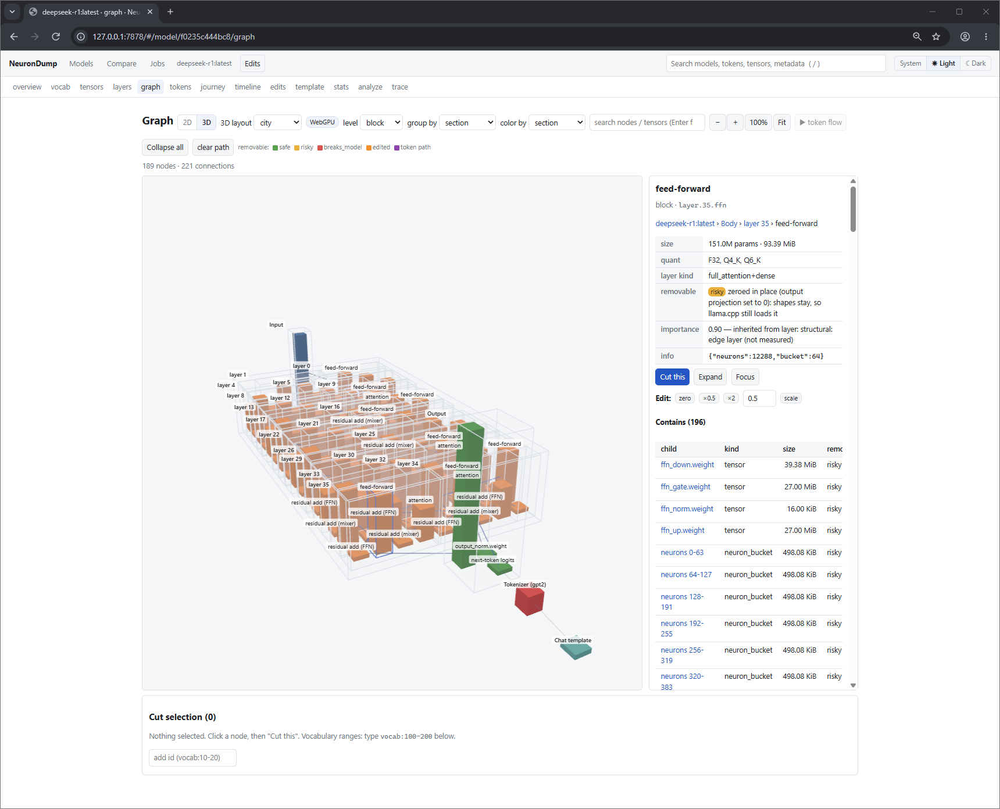
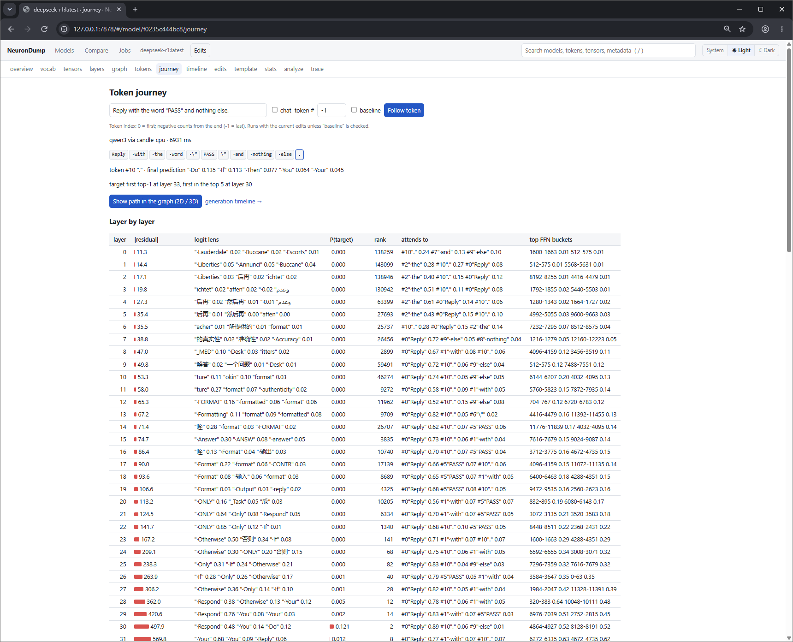
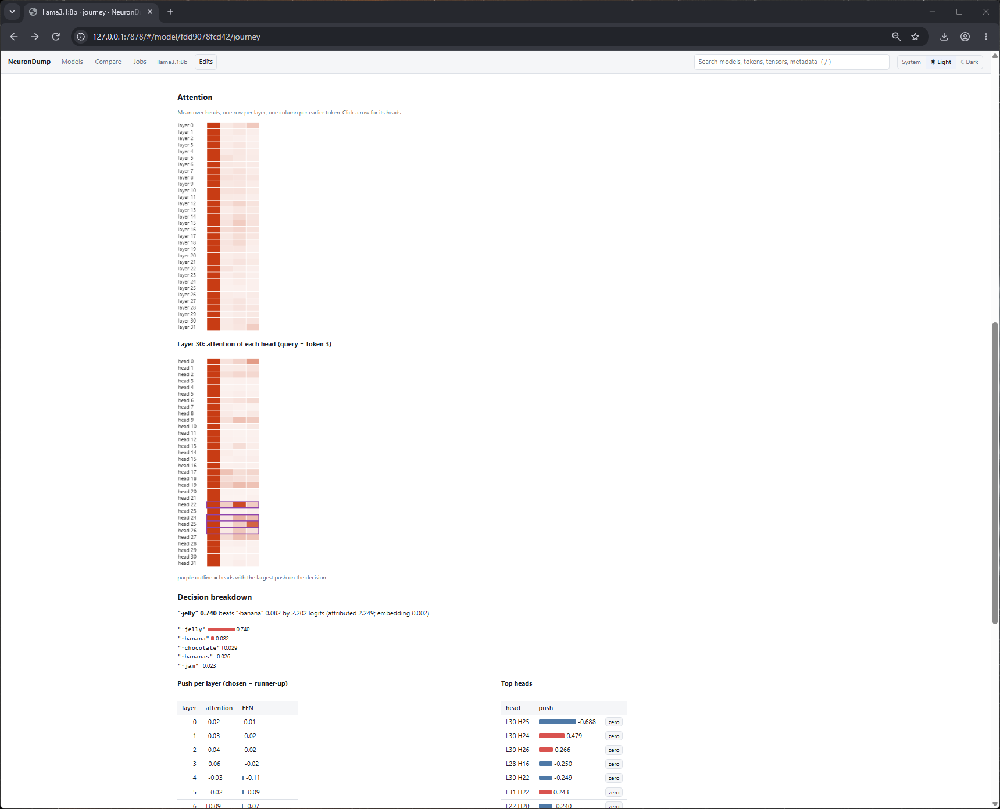
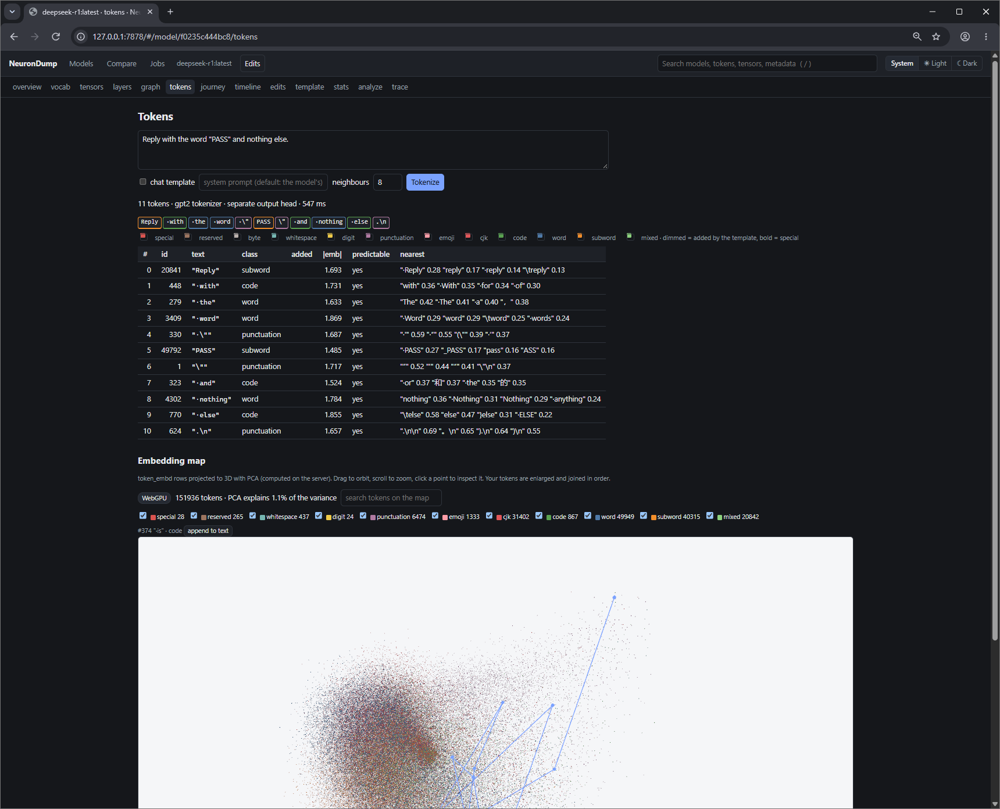
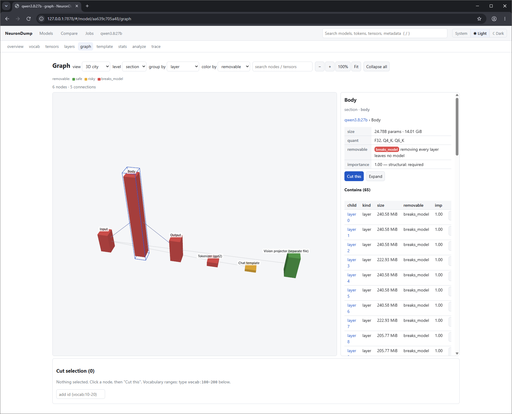
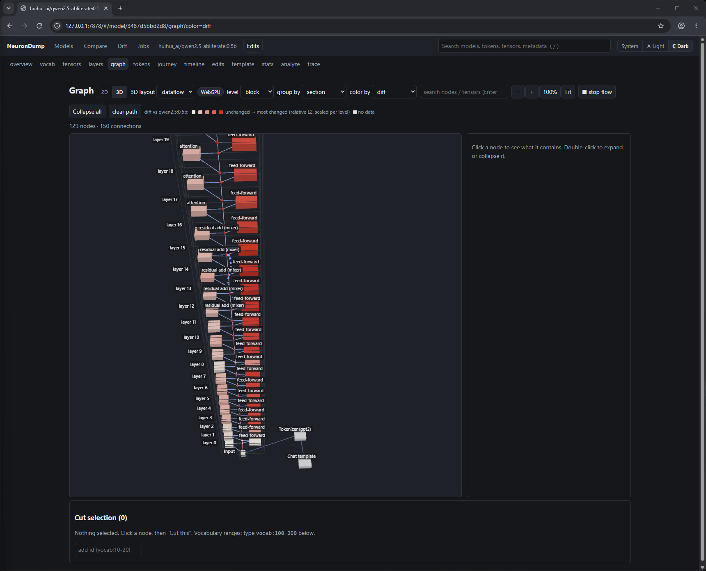

# NeuronDump

[](https://crates.io/crates/neurondump)
[](https://crates.io/crates/neurondump)
[](https://docs.rs/neurondump-core)
[](LICENSE)
[](https://github.com/aymen94/NeuronDump/actions/workflows/release.yml)

Look inside any local LLM, find the parts it doesn't need, and make it smaller.

NeuronDump reads **GGUF** model files (the format used by **Ollama** and **llama.cpp**) and
shows what is inside: layers, attention heads, vocabulary, chat template, weight statistics.
It can then remove unused parts and write a smaller GGUF that still runs in Ollama and llama.cpp.

It works with any model. It reads each file's own metadata; nothing is hard-coded per model.
With the `trace` feature it also runs supported models on the CPU, so you can follow a token
through every layer, see why it was chosen, and **edit the model live** (scale, zero, steer, patch,
ban…) with undo and a before / after comparison, then bake the edits into a new GGUF.



**Try it in your browser:** the [browser demo](https://aymen94.github.io/NeuronDump/demo/) inspects a `.gguf` file you
drop on the page, 100% locally (nothing is uploaded). Inspection only; the rest needs the app.

## Install

**Download:** ready-made Windows, Linux and macOS builds are on the
**[releases page](https://github.com/aymen94/NeuronDump/releases)**. Unzip and run `neurondump list`.
Download steps and checks: **[install guide](docs/install.md#download-a-ready-made-build)**.

**From crates.io:** with [Rust](https://rustup.rs) 1.88 or newer, run `cargo install neurondump`
(add `--features trace` to also run models).

**Build from source:** you need [Git](https://git-scm.com) and [Rust](https://rustup.rs) 1.88 or newer.
Step-by-step instructions: **[Windows, Linux and macOS install guide](docs/install.md)**.

**Windows** (PowerShell):

```powershell
winget install Git.Git
winget install Rustlang.Rustup              # then reopen PowerShell
git clone https://github.com/aymen94/NeuronDump
cd NeuronDump
cargo install --path crates/neurondump
neurondump list
```

**Linux**:

```sh
sudo apt install build-essential git curl   # or dnf / pacman
curl --proto '=https' --tlsv1.2 -sSf https://sh.rustup.rs | sh && source "$HOME/.cargo/env"
git clone https://github.com/aymen94/NeuronDump
cd NeuronDump
cargo install --path crates/neurondump
neurondump list
```

Add `--features trace` to `cargo install` to also run models (trace, token journey, generation
timeline, simulation and live edits).

The web UI's 3D engine, [wamr3d](https://www.npmjs.com/package/wamr3d), is vendored in
`crates/neurondump-web/frontend/vendor/wamr3d/` and embedded in the binary, so nothing is fetched at
run time. To refresh it (needs npm): `scripts/vendor-wamr3d.sh` (pinned version), then rebuild.

## Quick start

```sh
neurondump list                          # every local model
neurondump inspect llama3.2:1b           # what's inside a model
neurondump vocab llama3.2:1b --search hello
neurondump template llama3.2:1b          # the chat template as a tree
neurondump analyze llama3.2:1b --out plan.json
neurondump slim llama3.2:1b --plan plan.json --only vocab --out small.gguf
neurondump tokens llama3.2:1b "fn main() {" --chat     # tokens, template tokens, nearest tokens
neurondump web --open                    # the same, in your browser
```

With `--features trace`:

```sh
neurondump journey llama3.2:1b --prompt "The name of the star that Earth orbits is"          # one token through every layer
neurondump generate llama3.2:1b --prompt "The name of the star that Earth orbits is" --steps 8 --explain
neurondump edit llama3.2:1b --apply edits.json --prompt "The name of the star that Earth orbits is"   # baseline vs edited
neurondump edit llama3.2:1b --apply edits.json --bake llama-edited.gguf --no-compare
```

Run `neurondump` with no arguments to choose between the interactive CLI and the web interface.

## Look inside, cut, and see the impact

The web interface draws the model as a graph you can open up, in 2D or 3D. The 3D dataflow view runs
input → layer 0 … N → output up a column, with blocks around their layer and heads, neuron buckets and
experts on rings, all drawn with instanced meshes on wamr3d (WebGPU, or WebGL 2 automatically).
Tower, city and force layouts are there too. Everything is bundled, so it works offline.

- **Render inside any part:**
  - double-click a layer to see its attention and feed-forward blocks;
  - double-click attention to see its KV groups, then its individual heads;
  - feed-forward opens into neuron buckets, and MoE into experts.
- **Inspect:**
  - hover any part for its size and flag;
  - click it for its path, contents, connections, weight statistics, activations, importance,
    and whether it can be removed (`safe`, `risky` or `breaks_model`) and why.
- **Search inside:** type a tensor name like `blk.3.ffn_down`. Closed layers open to show it.
- **Cut (edit):** press **Cut this** on any part (a layer, a block, a head, a token range) to add
  it to a cut selection. Cut parts get a red outline.
- **Direct impact, instantly:** the panel shows:
  - parameters removed or zeroed, and the new file size;
  - what gets disconnected and what depends on the cut;
  - whether llama.cpp still loads the file;
  - a verdict.

  Dangerous cuts are refused unless you force them.
- **Simulated impact** (`--features trace`): the cut model runs in memory next to the original.
  You compare their next tokens, KL divergence, generated text, the logit lens per layer and
  perplexity. Nothing is written.
- **Sweep:** cuts each layer (or head) in turn, ranks them by damage, and colors the graph with it.
- **Save as plan → Slim:** writes the smaller GGUF and an Ollama Modelfile.

## Follow a token, change the model, see what happens

- **Tokens** (any model): token boundaries, ids, classes, the tokens the chat template adds, each
  token's embedding norm and nearest tokens, and a **3D embedding map** of the whole vocabulary
  (PCA of `token_embd`).
- **Token journey**: for any input or generated token, the logit lens per layer (where the answer
  first appears), attention per layer and head as heatmaps, the most active FFN neurons, and the
  **decision breakdown**: how much each layer, attention head and FFN pushed the chosen token
  against the runner-up. The path lights up in the 2D and 3D graph, and **token flow** animates it.
- **Generation timeline**: each step's token, probability, entropy and alternative; click a step
  for its decision breakdown.
- **Live edits**: scale or zero a layer, block, head, neuron bucket, neuron or expert; skip a layer;
  edit a token's embedding; ban or boost tokens; activation patching; steering vectors; sampling,
  forced tokens, system prompt and template. Every change runs baseline vs edited (text, top-k, KL,
  perplexity, logit lens, decision breakdown), with **undo / redo / restore all**, toggles, named
  snapshots and a portable `edits.json`. **Bake** writes a new GGUF; the original is never touched.







Details: [Interventions](docs/interventions.md), [Web interface](docs/web-ui.md).

## Supported architectures

- **Static analysis, graph, impact, slim, bake:** any GGUF architecture (layer kinds are read
  from the tensors: attention, linear attention / SSM, MoE, dense). **Tokenization** matches
  llama.cpp for BPE (llama3, qwen2, qwen3) and SPM (gemma, phi3); not yet for `gemma4`.
- **Runtime** (`--features trace`: trace, journey, timeline, simulation, sweeps, live edits): `llama`,
  `qwen2`, `qwen3`, `gemma`, `gemma2`, `gemma3`, `phi3`, `bert`, `nomic-bert`, checked against
  llama.cpp (gemma2 and Phi-3 128k only approximate). No MoE or hybrid (Qwen 3.5, Gemma 4) forward
  pass yet. See [Limitations](docs/limitations.md) and
  [Gemma 4, Gemma, Gemma 2 and Phi-3](docs/new-models.md).

The same works from the command line:

```sh
neurondump graph llama3.2:1b --expand layer.7.attn                  # inside a layer's attention
neurondump node llama3.2:1b layer.7.attn.head.3                     # inspect one head
neurondump ablate llama3.2:1b --cut layer.7 --static                # direct impact
neurondump ablate llama3.2:1b --cut layer.7 --prompt "The name of the star that Earth orbits is"   # simulated impact
neurondump sweep llama3.2:1b --corpus texts.txt --save-plan plan.json --top 2
neurondump slim llama3.2:1b --plan plan.json --out llama-14.gguf
```



Details: [Graph and ablation](docs/graph-and-ablation.md).

### Diff two models

Base vs fine-tune, Q4 vs Q8, or original vs slimmed: tensors are matched by name and compared
block by block, per layer, block and expert, plus metadata, vocabulary and chat template. The web
UI colors the graph with the result.

```sh
neurondump diff huihui_ai/qwen2.5-abliterate:0.5b qwen2.5:0.5b --top 10
```



## Documentation

| Page | What it covers |
|---|---|
| [Install and run](docs/install.md) | Windows and Linux, step by step |
| [Getting started](docs/getting-started.md) | find your models, first commands |
| [How it works](docs/internals.md) | what NeuronDump reads, and how |
| [Architecture](docs/architecture.md) | crates, core API, job system, graph, forward pass, edit overlay |
| [CLI reference](docs/cli.md) | every command and flag, and the REPL |
| [Web interface](docs/web-ui.md) | every page: graph, tokens, journey, timeline, edits, jobs |
| [HTTP API](docs/api.md) | every endpoint, with examples |
| [3D graph](docs/3d-graph.md) | wamr3d, backend fallback, layout, performance |
| [Interventions](docs/interventions.md) | ablation, edits, steering, patching, undo / restore, bake |
| [Limitations](docs/limitations.md) | unsupported architectures, experimental parts, WebGPU notes |
| [Changelog](CHANGELOG.md) | features by phase |
| [Analyze and slim](docs/analyze-and-slim.md) | making models smaller, safely |
| [Trace](docs/trace.md) | running a model and looking at each layer |
| [Graph and ablation](docs/graph-and-ablation.md) | the 3D / 2D graph: look inside layers, inspect, search, cut, direct and simulated impact |
| [What's inside real models](docs/models.md) | Qwen3 8B vs DeepSeek-R1, and Qwen 3.8 |
| [Building](docs/building.md) | build options and Windows notes |
| [Manual test plan](https://github.com/aymen94/NeuronDump/blob/main/TEST.md) | step-by-step checks |

A short illustrated explanation is on the [website](https://aymen94.github.io/NeuronDump/)
(source: [`docs/index.html`](docs/index.html)).

## Status

Early version, tested on Windows with Ollama models. Known gaps are listed in
[Limitations](docs/limitations.md); the manual checks are in [TEST.md](TEST.md). Bug reports and ideas: [issues](https://github.com/aymen94/NeuronDump/issues).

## License

Licensed under the [MIT License](LICENSE).
