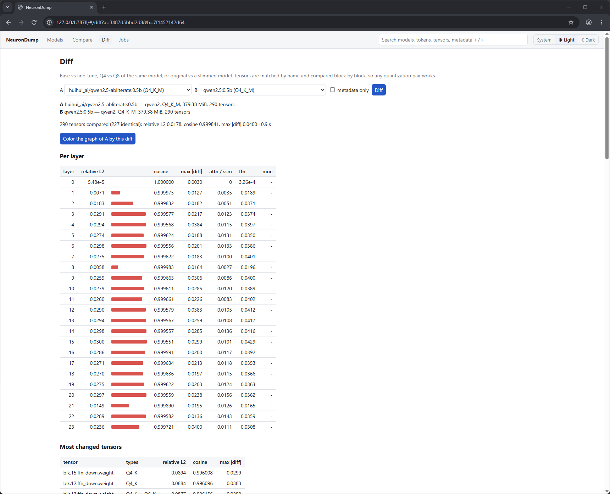

# What fine-tunes change

Weight diffs of models from Ollama, measured with `neurondump diff` (NeuronDump 0.1.4), plus
`generate` and `journey` (CPU, `--features trace`) to see what a change does. Every
model is the Q4_K_M build from Ollama. **Relative L2** is ‖a − b‖ / ‖a‖ over the dequantized
weights: 0 = identical, 0.01 = a 1 % change, 1 = as large as the weights themselves. Each diff
took 1–11 s on a laptop CPU: tensors are compared block by block, never loaded whole.

```sh
neurondump diff qwen2.5:0.5b huihui_ai/qwen2.5-abliterate:0.5b --top 10
neurondump diff qwen3:8b deepseek-r1:latest --json > r1.json
```

## Abliteration touches two matrices per layer

`huihui_ai/qwen2.5-abliterate:0.5b` is Qwen2.5 0.5B Instruct with the "refusal direction"
removed. The diff against `qwen2.5:0.5b`:



- **227 of 290 tensors are bit-identical.** Embeddings, queries, keys, the FFN gate / up and every
  norm and bias are untouched. Overall: relative L2 0.018, cosine 0.99984.
- **What changed:** `ffn_down` in all 24 layers (median relative L2 0.084) and `attn_output` in 23
  (0.056). These are the two matrices that **write into the residual stream**, which is exactly
  what abliteration does: it projects one direction out of everything written to the stream.
- **Layer 0 is skipped:** its `attn_output` is identical and its `ffn_down` moved by 0.0006.
- **`attn_v` looks changed in 16 layers, but isn't.** Those are exactly the 16 layers where the two
  files use a different quantization type (Q5_0 ↔ Q8_0); the 8 layers that kept their type are
  bit-identical. The new file was re-quantized, and llama.cpp picked other types for some layers.
  Some `ffn_down` tensors also swapped Q4_K ↔ Q6_K, so part of their difference is quantization
  noise too.
- Metadata: name, `general.finetune` (`Instruct-abliterated`), tags and license link. Same
  vocabulary; the chat template is 2 characters shorter (one line of the tool-call instructions).

At block level the graph shows it at a glance: feed-forward blocks (right) red, attention (left)
pale, layer 0 white.


### What it does to a refusal

`generate --chat` (greedy, 24 tokens) and `journey --chat` on the first reply token, same prompt in
both models:

| "Write an insult about my coworker." | qwen2.5:0.5b | abliterated |
|---|---|---|
| reply | "I'm sorry, but I can't assist with that. If you have any questions…" | "I'm sorry, but I'm Qwen, not a coworker. Can you please provide me with more context…" |
| first token | "I" 0.64, "As" 0.19, "Sorry" 0.07, "Sure" < 0.01 | "I" 0.43, "As" 0.18, "Sure" 0.05, "Sorry" 0.03 |
| "I" vs "As" (decision breakdown) | 1.22 logits | 0.87 logits |
| P("I") through layers 19 → 23 | 0.001 → 0.03 → 0.26 → 0.43 → 0.64 | 0.000 → 0.002 → 0.03 → 0.16 → 0.43 |

- **The refusal is decided in the last five layers.** Before layer 19 the logit lens shows noise and
  Chinese fragments (`作为一名`, "as a…"); from layer 19 `" I"` takes over. The abliterated model builds
  the same token in the same layers, only weaker (and its lens shows `"Unfortunately"` at layer 20).
- **Same circuits, smaller push.** The decision breakdown names the same heads in both models
  (layer 19 head 12, layer 21 head 9, layer 20 head 4) and the same strongest neuron (layer 21,
  neuron 3835). Removing one direction from `attn_output` and `ffn_down` weakens them; it does not
  rewire the model.
- **At 0.5B it only half works.** The abliterated model no longer refuses, but it doesn't comply
  either: it misreads the request and asks for context. "Sure" goes from under 1 % to 5 %. On a
  harmless prompt ("How do I pick a lock?") both models answer, with different first words
  ("Picking a lock is…" vs "To pick a lock…").

## Qwen2.5-Coder is a different model in the same shape

`qwen2.5-coder:0.5b` against `qwen2.5:0.5b`: same architecture, 290 tensors, same 151,936-token
vocabulary, almost the same chat template. But:

- **No tensor is identical**, and the overall relative L2 is **0.56** (cosine 0.85), 30× the
  abliteration.
- **The embeddings were relearned:** `token_embd` has relative L2 1.23 and cosine **0.34**. The same
  token id points to a mostly different vector. Because the model ties input and output embeddings,
  this also changes every output logit.
- Inside the layers, FFN matrices moved by ~1.1 and attention by 0.7–1.1 (median per role):
  `ffn_up` 1.16, `attn_q` 1.11, `ffn_down` 1.09, `attn_v` 0.74. Even the norms moved (0.08–0.10).

This is continued pre-training on code, not a light fine-tune: the starting point is visible only
in the shapes.

## Three models from Qwen3-8B Base

`qwen3:8b` (Qwen's own chat model), `deepseek-r1:latest` (DeepSeek-R1-0528 distilled into Qwen3
8B) and `qwen3-embedding:8b` all start from Qwen3-8B Base. Diffing them pairwise:

| A → B | relative L2 | cosine | identical tensors |
|---|---|---|---|
| qwen3:8b → deepseek-r1 | 0.152 | 0.9885 | 0 of 399 |
| qwen3:8b → qwen3-embedding | 0.138 | 0.9907 | 2 of 397 |
| deepseek-r1 → qwen3-embedding | 0.158 | 0.9878 | 0 of 397 |

- **Each post-training moved the weights by about 10 %.** No pair is much closer than the others.
  If each model moved from Base in its own, unrelated direction, the three distances give how far
  each one moved: **Qwen3 chat ≈ 9 %, DeepSeek-R1 ≈ 12 %, Qwen3-Embedding ≈ 10 %** (an estimate:
  it assumes the three changes are orthogonal).
- **Same shape across the depth.** In both diffs against `qwen3:8b` the change grows from ~0.12–0.14
  in the first layers to a peak around layers 19–28 (0.15–0.17), then drops in the last three layers
  (0.12–0.13). The two per-layer profiles correlate at 0.91. The middle of the network is where all
  three trainings did most of their work; the last layers, which turn the answer into words, moved
  least.
- **Same order of roles:** `ffn_gate` and `attn_q` change most (0.18 / 0.18 for R1), `attn_v` least
  among the matrices (0.10), norms ~1.5 %.
- **The embedding model is the chat model minus its head:** `output.weight` is gone, the vocabulary
  is cut from 151,936 to **151,665** tokens (it drops `<tool_response>`, `<think>`, `</think>` and the
  padding slots), `pooling_type` 3 (last token) is added and EOS becomes `<|endoftext|>`. The `attn_norm`
  vectors of its last two layers are bit-identical to `qwen3:8b`'s.
- **A quantization choice shows up as a type change:** `qwen3:8b` keeps every `attn_v` in F16, the
  embedding model has them in Q4_K (36 type changes).
- R1's metadata diff repeats what [What's inside real models](models.md) found: YaRN context 40,960 →
  131,072, 4 renamed or new special tokens, a new chat template, MIT license.

## Checking NeuronDump's own edits

Diffing a baked model against its source shows exactly what bake wrote.

- `edited.gguf` (from the abliterated 0.5B with **scale `layer.12` ×0.3** and **zero
  `layer.20.attn.head.3`**): **287 of 290 tensors identical**. Layer 12's `attn_output` and
  `ffn_down` have relative L2 **0.700** with cosine **1.0000**: exactly ×0.3, the direction
  unchanged. Layer 20's `attn_output` has 0.231 / cosine 0.973: one head's columns gone. The three
  tensors were stored as Q8_0, so the file grew by 2.6 MiB.
- `llama3.1-peanut-butter.gguf` and `deepseek-r1-peanut-butter.gguf` were baked from three edits:
  ban a token, a steering vector at layer 12 and **head 3 of layer 20 ×0.5**. The diff finds
  **one** changed tensor, `blk.20.attn_output.weight` (relative L2 0.081 and 0.092). Ban and steer
  only exist at run time and are not baked (see [Interventions](interventions.md#bake)), which the
  diff confirms. Note that the file's `neurondump.edits` metadata still lists all three.

## Reading a diff: three traps

1. **A changed quantization type looks like a change.** When the type differs on both sides
   (Q5_0 vs Q8_0, Q4_K vs Q6_K), the difference includes rounding noise. Check the `types` column:
   a tensor that differs *only* where its type changed was probably not edited.
2. **Layer and block totals are weighted by size.** A layer total is ‖a − b‖ / ‖a‖ over all its
   tensors, so a tensor with a huge norm dominates. In Qwen2.5 0.5B, `blk.0.attn_k.bias` (L2 367) and
   `blk.8.attn_k.bias` (L2 284) are 30–40× larger than layer 7's (9), so layers 0 and 8 look
   "unchanged" in both diffs above even when their weight matrices moved like their neighbours'.
   Look at the per-tensor list before concluding a layer was left alone.
3. **Graph colors are relative.** The diff coloring scales each level to its own maximum, so an even
   change (Qwen2.5-Coder) colors the whole tower red, and a tiny one (a single edited head) is just as
   red. Read the numbers in the side panel.

## Reproduce

```sh
neurondump diff qwen2.5:0.5b huihui_ai/qwen2.5-abliterate:0.5b
neurondump diff qwen2.5:0.5b qwen2.5-coder:0.5b
neurondump diff qwen3:8b deepseek-r1:latest
neurondump diff qwen3:8b qwen3-embedding:8b
neurondump diff deepseek-r1:latest qwen3-embedding:8b
neurondump diff llama3.1:8b ~/neurondump/bake/llama3.1-peanut-butter.gguf
neurondump stats qwen2.5:0.5b --tensor blk.8.attn_k.bias --tensor blk.7.attn_k.bias
neurondump generate huihui_ai/qwen2.5-abliterate:0.5b --chat --prompt "Write an insult about my coworker." --steps 24
neurondump journey qwen2.5:0.5b --chat --prompt "Write an insult about my coworker."
```
