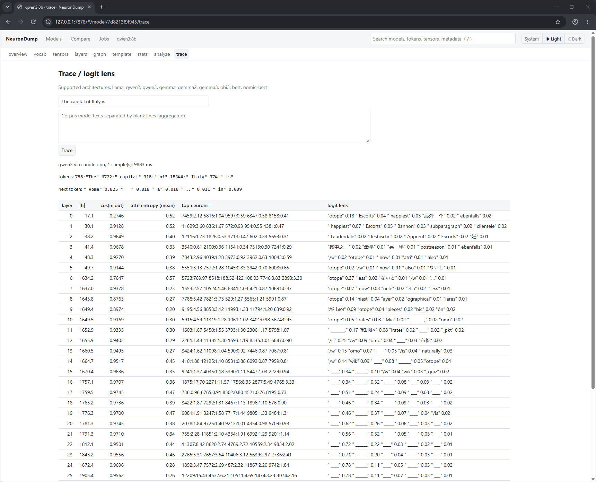

# Trace

Trace runs the model on your text and records what happens in every layer.
It needs a build with the `trace` feature:

```sh
cargo build --release --features trace
```

## Example

```sh
neurondump trace llama3.2:1b --prompt "The capital of Italy is"
```

```
LAYER  |h|    COS(in,out)  LOGIT LENS (top-5)
0      7.5    0.2959       " is" 1.00  " was" 0.00 ...
...
10     139.1  0.8817       "olit" 0.04  "polit" 0.02  " capitals" 0.01 ...
11     140.3  0.9130       " Rome" 0.35  " capitals" 0.07  " Naples" 0.04 ...
13     143.4  0.9279       " Rome" 0.85  " Venice" 0.02  " Milan" 0.02 ...
15     69.4   0.5629       " Rome" 0.84  " not" 0.03  " a" 0.03 ...
next token: " Rome" 0.838
```

## The columns

| Column | Meaning |
|---|---|
| `\|h\|` | size of the model's internal state after the layer |
| `COS(in,out)` | how similar the state is before and after the layer. Close to 1 means the layer changes little, which makes it a removal candidate |
| `ATTN ENTROPY` | how spread out attention is (low means each word looks at a few others) |
| `TOP NEURONS` | the feed-forward neurons that fired the most |
| `LOGIT LENS` | what the model would answer if it stopped at this layer |

The same view in the web interface (trace tab), here for qwen3:8b. " Rome" only appears at
layer 29, and the final prediction is " Rome" 0.825:



In the llama example the model "knows" the answer at layer 11: that's where " Rome" first appears.
By layer 13 it is sure (0.85).

## Several texts

```sh
neurondump trace llama3.2:1b --corpus texts.txt     # texts separated by blank lines
```

Values are averaged over all texts. The result is saved, and the next `analyze` uses it to
rank which layers can be removed.

## Embedding models

For models like `nomic-embed-text`, there is no next token. Instead, trace shows how much each
input token contributes to the final embedding.

## Supported architectures

`llama`, `qwen2`, `qwen3`, `gemma`, `gemma2`, `gemma3`, `phi3`, `bert`, `nomic-bert`.

Other models (for example hybrid Qwen 3.5) report "trace unsupported". All the other commands
still work on them. Tracing runs on the CPU and loads the whole model into memory: an 8B
model at 4 bits needs about 5 GB of RAM.
