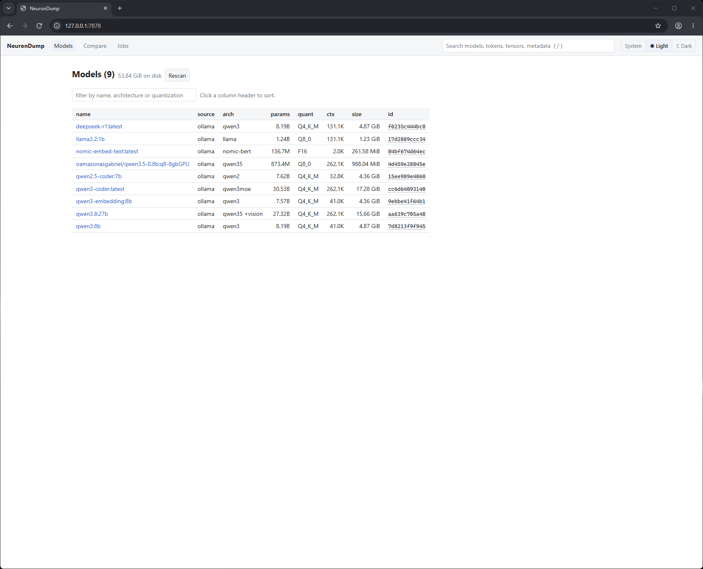
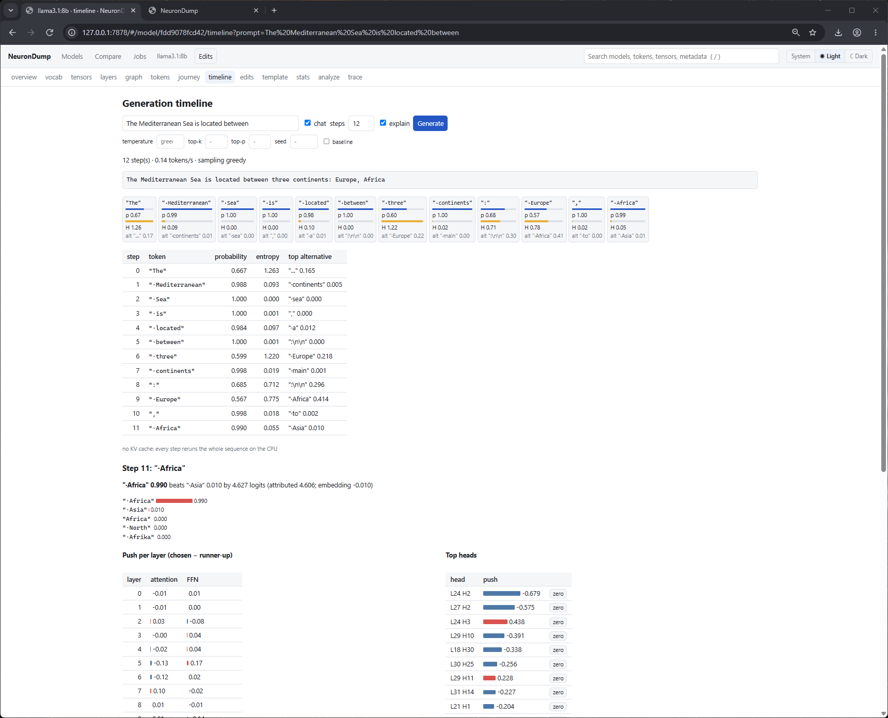
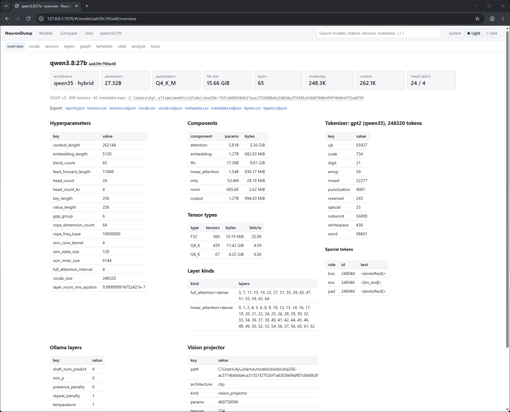
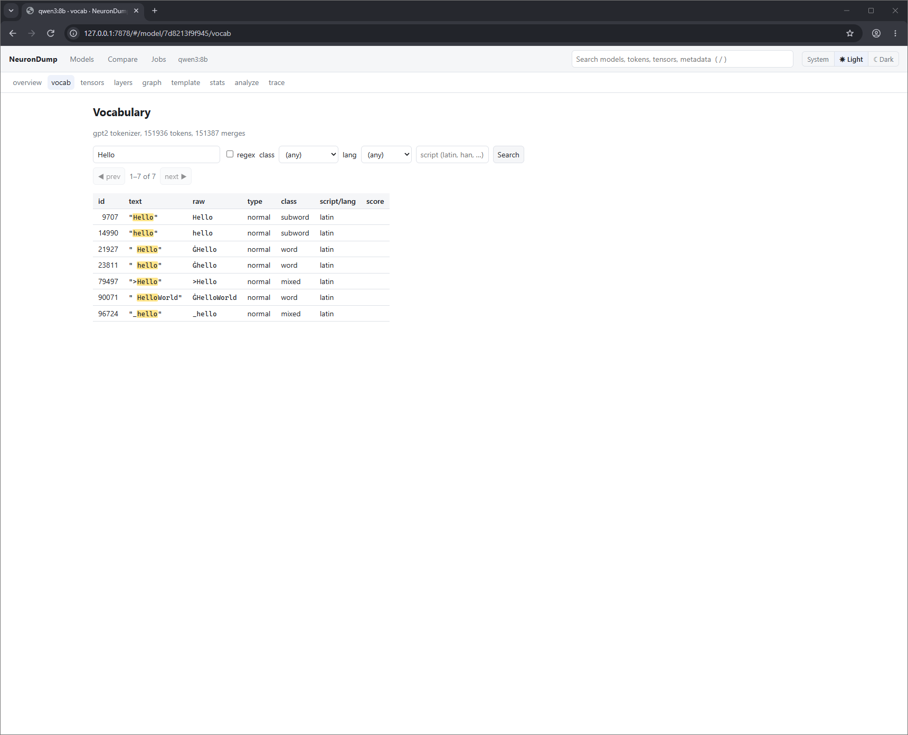
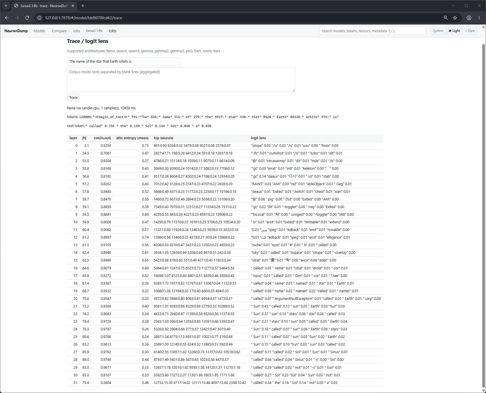
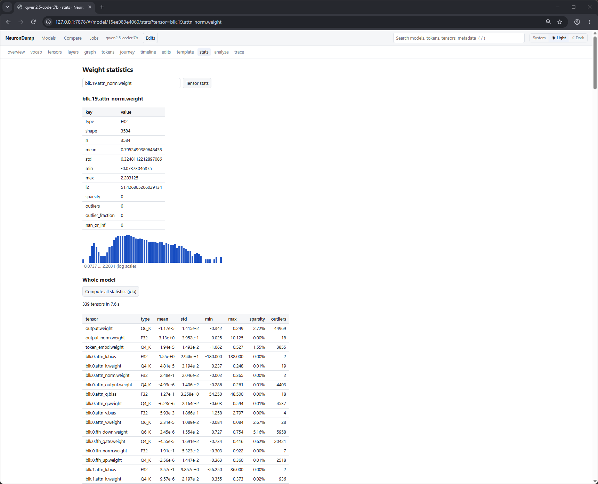
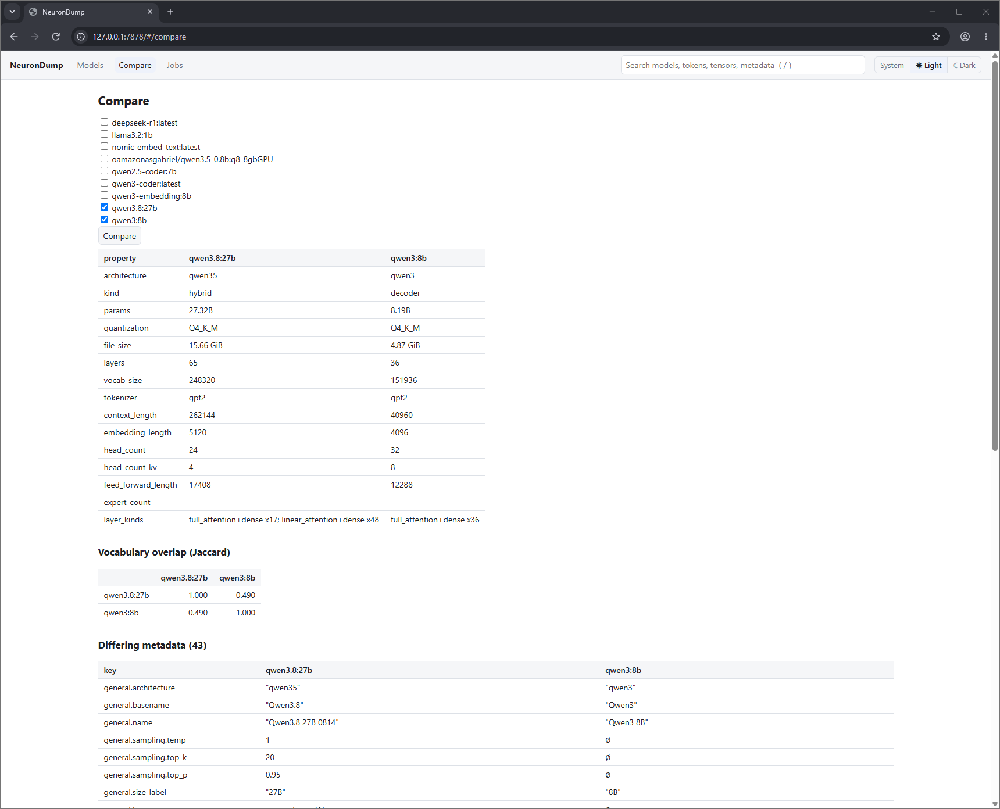

# Web interface

```sh
neurondump web --open            # default port 7878
neurondump web --port 9000
```

It prints a link like:

```
NeuronDump web UI: http://127.0.0.1:7878/?token=8cb862630b8fe923526d6c10f055950c
```

Open that link. The token is new at every start, and the page doesn't work without it. Everything
(including the 3D engine) is embedded in the binary, so the page works offline.



## Pages

| Page | What you see |
|---|---|
| **Models** | every local model, total disk size, filter box, sortable columns; Rescan |
| **Compare** | two or more models side by side, vocabulary overlap, differing metadata |
| **Jobs** | running and finished jobs, live progress, cancel, results |
| model › **overview** | summary cards, architecture, sizes, tokenizer, special tokens, Ollama settings, warnings, searchable metadata, export links |
| model › **vocab** | search the vocabulary, filter by class / language, page through 100k+ tokens |
| model › **tensors** | filter and sort tensors; click one for its statistics |
| model › **layers** | a colored map of the layers (attention, linear, MoE) |
| model › **graph** | the model as a 2D or 3D graph: open, inspect, search, cut, edit, simulate, sweep, token flow ([below](#graph)) |
| model › **tokens** | tokenization, the templated prompt, per-token embedding info, the 3D embedding map ([below](#tokens)) |
| model › **journey** | one token through the layers: logit lens, attention, FFN, decision breakdown ([below](#journey)) |
| model › **timeline** | generation step by step, with probabilities, entropy, alternatives ([below](#timeline)) |
| model › **edits** | the full edit page: stack, add, snapshots, compare, bake ([below](#edits)) |
| model › **template** | the chat template as a collapsible tree |
| model › **stats** | statistics and histogram for one tensor, or the whole model as a job |
| model › **analyze** | run an analysis, tick the candidates you want, press **Slim** |
| model › **trace** | run a prompt and see each layer's prediction |

The **Edits** button in the header opens the edit panel as a drawer on **every model page**. It
shows the number of active edits and turns orange when the model is edited.

journey, timeline, compare (and trace, simulate, sweep) need a build with `--features trace` and a
[supported architecture](limitations.md); other models show the reason and keep the static pages.

## Graph


- **2D / 3D** toggle; in 3D a layout menu: **dataflow** (default), tower, city, force. The badge
  next to it shows the renderer backend: `WebGPU`, `WebGPU (software)` or `WebGL 2`. See
  [3D graph](3d-graph.md).
- **level** (section, layer, block, tensor), **group by** (section, layer, block, quant, kind,
  importance), **color by** (removable, section, kind, quant, importance, damage, flow).
- **Click** a node for the side panel (path, size, removable flag, importance, stats, activation,
  contents, connections). **Double-click** (or **Expand**) opens it: layer → blocks → KV groups →
  heads; FFN → neuron buckets; MoE → experts. **Focus** flies the camera to it.
- **Search** (Enter) highlights and flies to matches; hidden tensors open their parents.
- **Edit:** buttons in the side panel push an edit for that node (zero, ×0.5, ×2, any factor, skip
  layer). Changed nodes get an orange outline in 2D and 3D.
- **Cut this** builds a cut selection with the live static impact; **Simulate** runs it in memory,
  **Apply as edit** puts it on the edit stack, **Sweep** ranks layers or heads by damage, **Save as
  plan → Slim** writes a smaller GGUF. See [Graph and ablation](graph-and-ablation.md).
- **▶ token flow** (3D dataflow): particles follow the last journey's token up the layers, which glow
  with their push on the prediction. **clear path** removes the purple token-path highlight that a
  journey's **Show path in the graph** adds.


## Tokens

- Type a text, optionally tick **chat template** (and a system prompt) and press **Tokenize**.
- With the template, the **full templated prompt** is shown with your text highlighted, so you see
  every token the template adds.
- Token chips: border color = token class, dimmed = added by the template or tokenizer, bold =
  special. A table lists id, text, class, the norm of the token's `token_embd` row, whether the
  model can predict it (`yes`, `no`, or `banned` by an edit) and its nearest tokens by cosine.
- Click a chip for details and actions: **journey of this token**, **show on map**, **ban**,
  **boost +5**, **embedding ×0** (the last three add edits).
- **Embedding map:** **Load embedding map** draws the vocabulary in 3D (PCA of `token_embd`).
  Colors are token classes (toggle each class in the legend), your tokens are enlarged and joined in
  order, search highlights matches, click a point to inspect it (and append it to the text).


deepseek-r1 splits the prompt into 11 tokens; `"PASS"` is one token whose nearest rows are `"·PASS"`,
`"_PASS"` and `"pass"`. On the map (151,936 tokens, WebGPU) the prompt's tokens are joined in order.

## Journey

Pick a prompt and a token index (`-1` = last; click any chip to switch) and press **Follow token**.

- **Layer by layer:** residual-stream norm, logit lens top 3 (what the model "thinks" at that
  layer), probability and rank of the final prediction, the earlier tokens it attends to most, the
  most active FFN neuron buckets. Above the table: the layer where the prediction first becomes
  top-1 and top-5.
- **Attention:** a heatmap of layers × earlier tokens (mean over heads); click a layer for its
  heads × tokens heatmap. Heads with the largest push on the decision are outlined in purple.
- **Decision breakdown:** final candidates with probabilities, then direct logit attribution: how
  much each layer's attention and FFN pushed the chosen token against the runner-up, the top heads
  and top neurons (each with a **zero** button that adds an edit). `attributed` is computed in exact f32 from the recorded activations; the model's own logits come from quantized matmuls (candle also quantizes the activations to 8 bits), so on quantized models the two can differ by a few tenths of a logit, which matters when the chosen token and the runner-up are close.
- **Show path in the graph** highlights the contributing layers, blocks, heads and buckets in the
  2D and 3D graph and sets the token for **token flow**.
- Runs with the current edits; tick **baseline** to ignore them. MoE routing and SSM state are not
  measured (no forward pass for those architectures).


The final prediction is `" jelly"` 0.740 (then `" banana"` 0.082, `" chocolate"` 0.029); it is first
in the top 5 at layer 27 and top-1 at layer 30. Up to layer 29 the logit lens reads "and" as
grammar (`"/or"`, as in "and/or"); `" PB"` shows up from layer 22, and only the last two layers
switch to the food.


The heatmaps: every layer attends mostly to `<|begin_of_text|>` (an attention sink); in layer 30,
heads 22, 24, 25 and 26 (outlined) push the decision most. The breakdown: `" jelly"` beats
`" banana"` by 2.202 logits; head 25 of layer 30 pushes against it (−0.688), head 24 for it (+0.479).

## Timeline

Generate N tokens (greedy, or with temperature / top-k / top-p / seed). Each step is a card with the
chosen token, its probability and the distribution's entropy as small bars, and the top alternative;
forced tokens (from a `force` edit) have an orange border. A table lists the same. **Click a step**
for its decision breakdown (computed on demand, or instantly with **explain**).



llama3.1:8b on "The Mediterranean Sea is located between" (chat, 12 steps, explain). The two
uncertain steps stand out by their entropy bar: `" three"` 0.599 against `" Europe"` 0.218, then
`" Europe"` 0.567 against `" Africa"` 0.414. Step 11 is open: `" Africa"` 0.990 beats `" Asia"` by
4.627 logits, with the push per layer and the top heads (L24 H2 first).

## Edits

The edit panel (drawer or full page):

- **Stack:** every edit with an on/off checkbox and ×; **↶ undo**, **↷ redo**, **restore all** (back
  to the original model, undoable). Changed node ids and notes are listed.
- **Add:** scale / zero a node, skip a layer, ablation cut, ban / boost a token, embedding row edit,
  steering vector (two prompts + strength), activation patching (layer, optional head, source prompt),
  sampling, forced token, system prompt, chat template. Tokens can be typed as text or `#id`.
- **Snapshots:** save the stack under a name, load it back; **export edits.json** / **import**.
- **Before / after:** a prompt, generated tokens and an optional corpus; **Compare** runs baseline vs
  edited: generated text side by side, top-k, KL, top-1 change, perplexity on the corpus, the logit
  lens of both, and how the decision breakdown changed per layer.
- **Bake:** writes the edits into a new GGUF in `~/neurondump/bake/` with a Modelfile, and prints the
  `ollama create` command.

See [Interventions](interventions.md) for what every edit does.

## Jobs

Long work (stats, analyze, slim, trace, ablate, sweep, journey, generate, compare, bake) runs as a
**job**, so the page stays usable. A number next to **Jobs** in the header counts the running ones.
Each job shows live progress and can be cancelled; results of deterministic jobs are cached
(`(cached)` in the progress line).

## Other screenshots

**Overview** of qwen3.8:27b: summary cards, hyperparameters, components, tensor types, layer kinds,
tokenizer, Ollama settings and the vision projector.



**vocab**: searching qwen3:8b's 151,936 tokens for "Hello", with matches highlighted.



**trace**: deepseek-r1 on "The name of the star that Earth orbits is". The last column is the logit lens: the answer appears at layer 29 (`"太阳"`, then `" Sun"`).


**trace**: llama3.1:8b on the same prompt. `" Sun"` is top-1 from layer 21 to 26, then `" called"`
takes over; the next token is `" called"` 0.336, `" the"` 0.159, `" Sol"` 0.144.



**stats**: qwen2.5-coder:7b, one tensor (`blk.19.attn_norm.weight`: 3,584 F32 values, mean 0.795,
histogram on a log scale) and the whole model as a job (339 tensors in 7.6 s). The attention biases
of layer 0 stand out: `blk.0.attn_k.bias` goes from −180 to 188.



**Compare**: qwen3.8:27b next to qwen3:8b.



## Search and shortcuts

- The **search box** in the header finds models by name, architecture or quantization; with a model
  open it also searches that model's tokens, tensors and metadata keys.
- **/** jumps to the search box, **Esc** leaves it.
- Click a **column header** to sort; click an id, name or path in `code` style to copy it.
- **System / Light / Dark** sets the theme (System follows the OS).

## Safety

- It listens on `127.0.0.1` only. `--host 0.0.0.0` makes it reachable from your network and prints
  a warning; avoid that on shared networks. Remote browsers then use WebGL 2 (WebGPU needs a secure
  context, see [3D graph](3d-graph.md#backend-auto)).
- Every API call needs the session token.
- Models are referred to by id, never by file path. Slim and bake outputs are plain file names
  written under the output folder (`~/neurondump/slim/`, `~/neurondump/bake/`).

The HTTP API is documented in [API](api.md).
